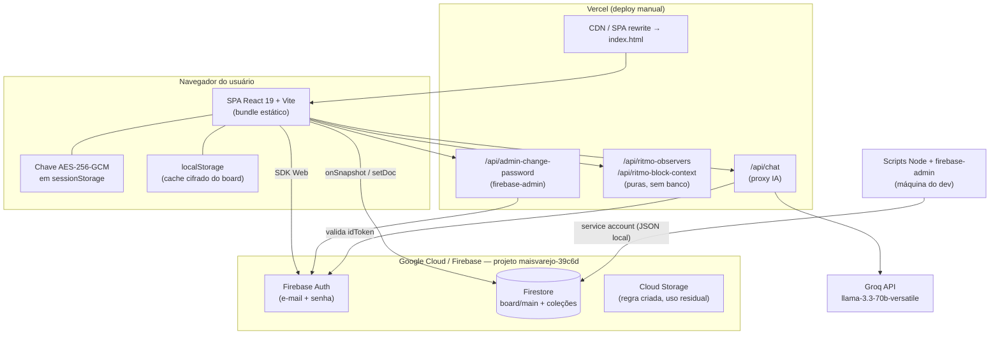

# Mapeamento Técnico — Mavo Gestão

> **Repositório:** `willy-henrique/bloco-maisvarejo` (branch `main`)
> **Nome comercial:** Mavo Gestão — "Estratégico 5W2H · Dashboard de Gestão"
> **Versão do pacote:** 2.3.2
> **Histórico:** 102 commits entre 02/02/2026 e 14/05/2026 (último commit: 14/05/2026)
> **Documento gerado em:** 28/08/2026 — a partir da leitura do código-fonte
> **Responsável técnico:** Willy Dev (`willydev01@gmail.com`)

Este documento responde ao *Template de Mapeamento de Produto/Módulo*. O sistema foi
quebrado em **5 blocos** (aplicação principal + serviços satélites), porque cada um tem
uma topologia de execução diferente e precisa de decisões de nuvem distintas.

| # | Bloco | Onde roda hoje | Criticidade |
|---|-------|----------------|-------------|
| 1 | SPA Mavo Gestão (produto) | Vercel (CDN estática) | Alta — é o produto |
| 2 | Funções serverless `/api` | Vercel Functions | Média |
| 3 | Firebase (Auth + Firestore + Storage) | Google Cloud (BaaS gerenciado) | **Crítica — é o banco** |
| 4 | Scripts administrativos Node | Máquina do desenvolvedor | Baixa (mas com credencial root) |
| 5 | `auto-commit.exe` (ferramenta interna) | Máquina do desenvolvedor | Baixa |

---

## Visão geral da topologia



**Resumo em uma frase:** é um **SPA "fat client"** — praticamente toda a regra de negócio
roda no navegador, o Firestore é usado como banco em tempo real e as funções serverless
são periféricas (proxy de IA + 2 helpers sem estado + 1 operação administrativa).

---

# BLOCO 1 — Mavo Gestão (aplicação principal / SPA)

## 1. Identificação Básica

- **Nome do Produto/Serviço:** Mavo Gestão (interno: *Estratégico 5W2H — Dashboard de Gestão*)
- **Empresa/Vertical Responsável:** Mavo Tech *(a confirmar com a diretoria — o produto atende hoje os workspaces "Mais Varejo" e "Auge" dentro da mesma instância)*
- **Status Atual:** **(X) Em Produção** — publicado em `mavo-gestao.vercel.app` (e `bloco-maisvarejo.vercel.app`), com manual de treinamento e screenshots já entregues aos usuários (`docs/manual-treinamento-mavo-gestao.pdf`)

**Para que serve:** operacionaliza o método *Ritmo de Gestão Simplificado / 5W2H* em três
níveis encadeados — **Backlog → Prioridade (estratégico) → Plano de Ataque (gerencial, 5W2H
completo) → Tarefa (operacional)** — com quadro kanban, agenda, chat de equipe, painel de
desempenho, roadmap e assistente de IA.

**Invariantes de domínio** (fonte: `MAVO_CONTEXT.md` e `docs/mavo-requisitos-funcionais.md`):
- toda Prioridade tem **dono único e obrigatório**;
- **máximo de 3 prioridades** não concluídas por quadro;
- **propagação de bloqueio**: tarefa bloqueada → plano bloqueado → prioridade bloqueada;
- **observadores** acompanham sem assumir ownership (o criador entra automaticamente);
- colaboração **cross-workspace** só com permissão explícita (`cross_workspace_view` / `cross_workspace_assign`).

## 2. Anatomia do Código (a Stack)

| Camada | Tecnologia |
|---|---|
| **Frontend / Interface** | **React 19.2 + TypeScript 5.8**, SPA compilada com **Vite 6**, roteamento `react-router-dom` 7, estilo **Tailwind CSS 4** (via `@tailwindcss/postcss`), ícones `lucide-react`. Sem SSR, sem framework de aplicação (não é Next.js). |
| **Backend / Regras de Negócio** | **Não existe backend de domínio.** As regras (limite de 3 prioridades, propagação de bloqueio, tombstones, permissões por módulo, visibilidade) vivem em hooks-controladores no cliente: `controllers/useRitmoGestao.ts` (1.536 linhas), `useStrategicBoard`, `useAgenda`, `useChat`, `useGeneralChat`. O que existe de servidor são 4 funções serverless (Bloco 2). |
| **Banco de Dados Atual** | **Cloud Firestore** (projeto `maisvarejo-39c6d`) como fonte de verdade + **localStorage/sessionStorage** cifrados como cache offline/otimista. **Não há SQL em lugar nenhum.** |
| **Autenticação** | Firebase Auth (e-mail/senha). Perfil, papel e permissões em `users/{uid}`. Convive com um contexto legado de senha única PBKDF2 (`contexts/AuthContext.tsx`) — dívida técnica, ver §4. |
| **Criptografia** | AES-256-GCM via Web Crypto (`services/encryptionService.ts`); chave derivada/importada de `VITE_APP_PASSWORD_HASH` e guardada em `sessionStorage`. |
| **Build/Deploy** | `vite build` → estático; `npx vercel --prod` (script `npm run publish`). `vercel.json` faz rewrite `/(.*) → /index.html`. |
| **Testes** | **Nenhum** — não há suíte, runner ou script de teste no `package.json`. |

**Tamanho e forma do código (indicadores de manutenção):**

```
App.tsx ............................. 2.372 linhas (99 KB)
components/Dashboard/EstrategicoView   2.156
components/Dashboard/OperacionalView   1.714
components/Dashboard/TeamChatView ...  1.559
controllers/useRitmoGestao.ts .......  1.536
components/Dashboard/AgendaView .....  1.177
```

**Módulos funcionais (views) e rotas:**

- Views: `workspace`, `backlog`, `dashboard` (Estratégico), `table` (Gerencial 5W2H), `operacional`, `performance`, `roadmap`, `agenda`, `chat`.
- Rotas: `/*` (app), `/admin/*` (gestão de usuários), `/willydev/*` (painel do desenvolvedor + telemetria), `/pro/*` (protótipo com "itens avulsos": tarefas sem plano e planos sem prioridade).

## 3. Arquitetura e Integração

**Onde o código roda hoje?**
- Bundle estático servido pela **CDN da Vercel** (deploy manual, sem pipeline). Execução real: **navegador do usuário**.
- Sem servidor de aplicação, sem container, sem VM, sem VPS.
- **Só existe ambiente de produção** — não há projeto/deploy de homologação.

**Com quem ele precisa conversar?**

| Destino | Protocolo | Finalidade |
|---|---|---|
| **Firebase Auth** (`identitytoolkit` / `securetoken`) | SDK Web / HTTPS | Login, sessão, token |
| **Cloud Firestore** | SDK Web (WebChannel, `onSnapshot` em tempo real) | Board, usuários, chat, presença, agenda, configurações |
| **`/api/chat` → Groq** | HTTPS/JSON | Assistente de IA (modelo `llama-3.3-70b-versatile`) com dois personas no system prompt: consultor 5W2H e **"Tilli"** (programa *Parceiro+* da TILLIT — Hiper/Linx/TEF) |
| **`/api/ritmo-*`** | HTTPS/JSON | Normalização de observadores e contexto de bloqueio (funções puras, sem persistência) |
| **`/api/admin-change-password`** | HTTPS/JSON | Troca de senha de usuário por administrador (Firebase Admin SDK) |
| **Google Fonts** | HTTPS | Fonte Inter |

**Integrações que NÃO existem hoje (importante para não superdimensionar a nuvem):**
- ❌ Nenhuma leitura de banco legado (Firebird/Delphi) — o produto nasceu web-only;
- ❌ Nenhuma API de governo / fiscal;
- ❌ Nenhum ERP (Hiper, Linx, TEF) integrado — o Parceiro+ aparece apenas como **conhecimento no prompt do chatbot**, não como integração de dados;
- ⚠️ **Google Calendar:** existiu (há commits de convite/exclusão de evento) mas **foi removido do código**. As variáveis `VITE_GOOGLE_CLIENT_ID`, `VITE_GOOGLE_CALENDAR_URL` e `VITE_GOOGLE_CALENDAR_EMBED_URL` continuam no `.env` sem uso — **configuração morta, candidata a limpeza ou a reativação**.

**Modelo de persistência (o ponto mais importante para a arquitetura de nuvem):**

Todo o domínio de gestão vive em **um único documento**: `board/main`, campo
`ritmoEncrypted` — um blob AES-GCM que contém, juntos, `backlog[] + prioridades[] +
planos[] + tarefas[] + responsaveis[] + empresas[] + _tombstones`.

```
board/main
 ├── itemsEncrypted   → matriz 5W2H legada (ActionItem[])
 ├── notesEncrypted   → notas do diretor
 └── ritmoEncrypted   → TODO o Ritmo de Gestão, cifrado, em um só campo
```

Consequências diretas, já visíveis no código:
- toda alteração (mover um card, marcar uma tarefa) **reescreve o board inteiro** (`setDoc(..., { merge: true })`, `services/firestoreSync.ts:181`);
- todo cliente conectado **recebe e descriptografa o board inteiro** a cada mudança de qualquer usuário;
- não existe query/filtro/índice no servidor — filtragem por workspace, dono e visibilidade é **100 % client-side**;
- para evitar "ressurreição" de itens deletados em edição concorrente, foi preciso construir no cliente um mecanismo de **tombstones + guard de deleção de 120 s + fila de persistência** (`controllers/useRitmoGestao.ts:36-43`, `types/index.ts` → `RitmoBoardTombstones`) — sintoma clássico de *last-write-wins* sem transação.

As demais coleções **são** normalizadas: `users`, `appSettings/config`, `presence/{uid}`,
`privateChats/{id}/messages`, `generalChat/main/messages`, `userAgenda/{uid}` (+
subcoleções `agendaInvites`, `eventInvites`), `director_notes`, `dev_usage`,
`strategic_items`, `chat`.

## 4. O Gargalo e o Futuro

### 4.1 Qual é a maior "dor" hoje

**① Banco monolítico em um documento (dor nº 1, de longe).**
`board/main` acumula todo o domínio num blob cifrado. Isso cria, ao mesmo tempo:
teto rígido de **1 MiB por documento** no Firestore (o board cresce linearmente com o uso
e vai bater nesse teto), **concorrência de "última escrita vence"**, **impossibilidade de
query no servidor**, **banda proporcional a `usuários × tamanho do board × frequência de
edição`** e uma camada de defesa artesanal (tombstones/guards) que já responde por
parte relevante da complexidade do controlador.

**② A criptografia não é o controle de acesso que parece ser.**
A chave AES é **única e global**, derivada de `VITE_APP_PASSWORD_HASH` — que, por ser
`VITE_*`, **vai embutida no bundle JavaScript entregue ao navegador**. Somada à regra
`match /board/{docId} { allow read, write: if isAuthenticated(); }`
(`firestore.rules:22`), o efeito prático é: **qualquer usuário autenticado consegue ler e
descriptografar o board inteiro da empresa**, inclusive itens de workspaces e pessoas a
que ele não deveria ter acesso. A separação por dono/observador/workspace é **cosmética
(UI)**, não é imposta pelo servidor. Isso é uma questão de conformidade, não só de código.

**③ Ausência total de pipeline e de ambiente de homologação.**
Deploy é `npm run publish` na máquina do dev; commits são gerados por um `.exe` com
mensagem datada (daí o histórico com muitos *"feat: atualizações do projeto"*). Não há
build de verificação, type-check em CI, preview por PR, nem rollback documentado. Um
`tsc` quebrado só aparece em produção.

**④ Sem testes e com componentes gigantes.**
Zero testes automatizados; `App.tsx` com 2.372 linhas e três views acima de 1.500 linhas.
Qualquer mudança em regra de bloqueio/permissão é validada manualmente.

**⑤ Duas camadas de autenticação convivendo.**
`AuthContext` (senha única PBKDF2 do ambiente) + `UserContext` (Firebase Auth por usuário).
A primeira é legado, mas ainda alimenta o slot de chave usado pelo chat cifrado.

**⑥ Inconsistência e desperdício nas funções serverless.**
Dois estilos de handler no mesmo diretório (`export default { fetch }`, estilo Workers, em
`api/chat.ts` e `api/ritmo-*.ts` vs. `module.exports = (req, res)` em
`api/admin-change-password.js`). Os handlers `ritmo-observers` e `ritmo-block-context`
**não tocam em banco nenhum** — recebem o array, transformam e devolvem: é uma ida à rede
para fazer o que o cliente já faria localmente. E `api/chat.ts` "valida" o token
chamando `accounts:lookup` do Identity Toolkit em vez de `verifyIdToken` do Admin SDK.

**⑦ Segredos gerenciados à mão.**
Os scripts administrativos esperam o JSON de *service account* (`maisvarejo-39c6d-firebase-adminsdk-*.json`)
**no diretório de trabalho do desenvolvedor**; a função admin espera `FIREBASE_SERVICE_ACCOUNT_JSON`
como variável de ambiente. Não há cofre, rotação nem trilha de uso. `GROQ_API_KEY` idem.

**⑧ Sem observabilidade e sem backup.**
Nenhum APM, log estruturado ou alerta — o que existe é telemetria caseira (`dev_usage`,
heartbeat de 2 min) visível só no painel do desenvolvedor. Não há export/PITR configurado
para o Firestore: hoje **não existe plano de recuperação de dados**.

**⑨ Chatbot de IA sem trava.**
`/api/chat` chama a Groq com o system prompt inteiro a cada requisição, sem rate limit por
usuário, sem cache, sem registro de conversas e sem RAG — o conhecimento do Parceiro+ está
*hardcoded* no prompt (`api/chat.ts`), então mudar a tabela de comissão exige novo deploy.

### 4.2 O que essa aplicação vai precisar da Nuvem em breve

Em ordem de retorno sobre esforço:

1. **Banco de dados gerenciado com dados normalizados.** Sair do blob único. Duas rotas:
   (a) permanecer no Firestore quebrando `board/main` em coleções (`ritmo_prioridades`,
   `ritmo_planos`, `ritmo_tarefas`, `ritmo_backlog`) com regras por dono/observador/workspace
   e índices compostos; ou (b) migrar para **PostgreSQL gerenciado** com uma API própria,
   se o grupo padronizar em SQL para conversar com o mundo legado. **É a decisão de
   arquitetura mais urgente** e precisa ser tomada antes de o board bater o limite de 1 MiB.
2. **PaaS para uma API de domínio.** Hoje o cliente é dono das regras; mover as invariantes
   (limite de 3 prioridades, propagação de bloqueio, permissão cross-workspace) para um
   serviço com autorização real. Um PaaS leve (Cloud Run / Vercel Functions com runtime
   Node padronizado) já resolve — **não há necessidade de VM nem de GPU**.
3. **Ambiente de homologação isolado** (projeto Firebase HML + preview automático na Vercel)
   e **CI/CD** com type-check, build e deploy por *merge* — hoje inexistentes.
4. **Cofre de segredos + rotação** (service account do Firebase, `GROQ_API_KEY`) e
   remoção da chave AES global do bundle.
5. **Backup gerenciado / PITR + export agendado do Firestore**, com teste de restauração.
6. **Observabilidade** (APM, log estruturado, alerta de erro e de custo do Firestore).
7. **Gateway para IA**, se o Tilli crescer: rate limit por usuário, log de conversas e
   base de conhecimento fora do código (RAG com banco vetorial gerenciado). **Continua sem
   necessidade de GPU própria** — a inferência é SaaS (Groq).
8. **A definir com o grupo:** se o Mavo Gestão precisar consumir dados do **legado Delphi/
   Firebird** (indicadores de venda, carteira, contratos), será necessário um caminho de
   integração que hoje **não existe em nenhuma linha do código**: agente/ETL na ponta →
   fila ou API na nuvem → banco analítico. Isso muda a topologia e precisa entrar no
   desenho desde já, se for prioridade da diretoria.

---

# BLOCO 2 — Funções serverless `/api`

## 1. Identificação Básica
- **Nome:** API auxiliar do Mavo Gestão (`api/`)
- **Empresa/Vertical:** mesma do Bloco 1
- **Status:** **(X) Em Produção** (acompanha o deploy do SPA)

## 2. Anatomia do Código
- **Frontend/Interface:** nenhuma (background/HTTP)
- **Backend:** **TypeScript/JavaScript em Vercel Functions** — 4 endpoints:
  - `POST /api/chat` — proxy autenticado para a **Groq** (`llama-3.3-70b-versatile`), system prompt com as personas 5W2H e "Tilli/Parceiro+", CORS restrito a uma lista de origens;
  - `POST /api/ritmo-observers` — adiciona/remove observador (função pura, sem banco);
  - `POST /api/ritmo-block-context` — resolve a causa raiz de bloqueio de um plano (função pura, sem banco);
  - `POST /api/admin-change-password` — troca de senha via **firebase-admin**, exigindo `role = administrador` conferido no Firestore.
- **Banco de Dados:** nenhum próprio; apenas `admin-change-password` toca Firebase Auth/Firestore.

## 3. Arquitetura e Integração
- **Onde roda:** Vercel Functions, no mesmo projeto do SPA.
- **Conversa com:** Groq API, Firebase Auth (verificação de token), Firestore (leitura de `users` para checar o papel).
- **Segredos consumidos:** `GROQ_API_KEY`, `FIREBASE_SERVICE_ACCOUNT_JSON`, `VITE_FIREBASE_PROJECT_ID`, `VITE_FIREBASE_API_KEY`.

## 4. Gargalo e Futuro
- **Dor:** dois estilos de handler no mesmo diretório; dois endpoints que existem sem
  motivo técnico (não persistem nada); validação de token frágil em `/api/chat`;
  nenhum rate limit — a chave da Groq fica exposta a abuso por qualquer usuário autenticado.
- **Precisa da nuvem:** runtime padronizado, rate limiting/WAF na borda, secret manager e
  log/alerta de custo por chamada de IA. É aqui que a **API de domínio** do Bloco 1 deveria
  nascer, se a decisão for manter serverless.

---

# BLOCO 3 — Firebase (Auth + Firestore + Storage)

## 1. Identificação Básica
- **Nome:** Projeto Firebase `maisvarejo-39c6d` — plataforma de dados do Mavo Gestão
- **Status:** **(X) Em Produção** — instância **única**, sem homologação

## 2. Anatomia
- **Firebase Auth:** e-mail/senha; usuários criados pelo painel `/admin` (que usa um app secundário para não deslogar o administrador) e pelos scripts do Bloco 4.
- **Cloud Firestore:** coleções — `board` (monolito cifrado), `users`, `appSettings`, `presence`, `privateChats/{id}/messages`, `generalChat/main/messages`, `userAgenda/{uid}` (+ `agendaInvites`, `eventInvites`), `director_notes`, `dev_usage`, `strategic_items`, `chat`.
- **Cloud Storage:** `storage.rules` libera `/strategic/**` para autenticados; uso residual.
- **Regras:** `firestore.rules` (≈290 linhas) com *deny-all* final — bem construídas para agenda, chat e usuários; **permissivas para o board** (qualquer autenticado lê e escreve).

## 3. Arquitetura e Integração
- **Onde roda:** Google Cloud (gerenciado). Acesso direto do navegador via SDK Web; acesso privilegiado por service account nos scripts e na função admin.
- **Papéis:** `administrador`, `gerente`, `usuario` + um perfil especial de **desenvolvedor** identificado por e-mail/nome fixos em `config/developer.ts`. Permissões finas por módulo em `types/modulePermissions.ts` (`read`, `create`, `edit`, `delete`, `workflow`, `tarefa_assign`, `observer_edit`, `cross_workspace_view`, `cross_workspace_assign`…), versionadas por `PERMISSIONS_SCHEMA_VERSION = 3`.

## 4. Gargalo e Futuro
- **Dor:** modelo de dados do board (ver §4.1 do Bloco 1); regra de leitura ampla no board;
  sem backup/PITR; sem separação prod/HML; custo de leitura tende a crescer de forma não
  linear com o número de usuários conectados simultaneamente.
- **Precisa da nuvem:** projeto de homologação, política de backup e retenção, revisão das
  regras após a normalização do board, e monitoramento de custo/quota.

---

# BLOCO 4 — Scripts administrativos (Node + firebase-admin)

## 1. Identificação Básica
- **Nome:** Utilitários de operação (`scripts/`)
- **Status:** **(X) Em Produção** (uso pontual, manual)

## 2. Anatomia
- **Interface:** CLI (Node 18, CommonJS)
- **Backend:** `firebase-admin`; alguns scripts descriptografam/recriptografam o board com a mesma chave AES do app
- **Scripts:** `create-admin-user`, `create-dev-user`, `generate-password-hash`, `rename-workspace-firestore` (renomeia o workspace `Mavo → Auge` dentro do blob cifrado), `cleanup-mavo-workspace`, `capture-training-screenshots`, `generate-training-pdf`

## 3. Arquitetura e Integração
- **Onde roda:** **máquina do desenvolvedor**, lendo o JSON de service account do diretório atual e o `.env` do projeto.
- **Conversa com:** Firestore e Firebase Auth com **privilégio total**.

## 4. Gargalo e Futuro
- **Dor:** operação de produção depende de uma credencial *root* em uma máquina pessoal,
  sem cofre, sem trilha de auditoria e sem *dry-run* padronizado. Uma migração de workspace
  errada reescreve o board inteiro.
- **Precisa da nuvem:** mover essas rotinas para *jobs* executados na nuvem (Cloud Run Jobs
  ou equivalente) com identidade gerenciada, log de execução e aprovação — e rotacionar a
  service account atual.

---

# BLOCO 5 — `auto-commit.exe` (ferramenta interna de produtividade)

## 1. Identificação Básica
- **Nome:** auto-commit (`scripts/auto-commit.cjs`, empacotado com `pkg` para `dist/auto-commit.exe`)
- **Status:** **(X) Em Produção** (uso interno do desenvolvedor)

## 2. Anatomia
- **Interface:** CLI Windows (`node18-win-x64`) · **Backend:** Node + Git · **Banco:** nenhum

## 3. Arquitetura e Integração
- Roda na máquina do dev; faz `git add .` + commit datado + `push` opcional para o GitHub.

## 4. Gargalo e Futuro
- **Dor:** produz histórico pouco informativo (mensagens genéricas repetidas), o que
  dificulta auditoria, *code review* e rollback.
- **Precisa da nuvem:** nada. Deve ser substituído por commits convencionais + CI quando o
  pipeline do Bloco 1 existir.

---

# Anexo A — Variáveis de ambiente (apenas nomes; valores não versionados)

| Variável | Escopo | Observação |
|---|---|---|
| `VITE_FIREBASE_API_KEY` | Cliente (bundle) | Config pública do Firebase |
| `VITE_FIREBASE_AUTH_DOMAIN` | Cliente | |
| `VITE_FIREBASE_PROJECT_ID` | Cliente + funções | `maisvarejo-39c6d` |
| `VITE_FIREBASE_STORAGE_BUCKET` | Cliente | |
| `VITE_FIREBASE_MESSAGING_SENDER_ID` | Cliente | |
| `VITE_FIREBASE_APP_ID` | Cliente | |
| `VITE_FIREBASE_MEASUREMENT_ID` | Cliente | |
| `VITE_APP_PASSWORD_SALT` | Cliente | PBKDF2 (login legado) |
| `VITE_APP_PASSWORD_HASH` | Cliente | **Deriva a chave AES global — hoje vai no bundle** |
| `VITE_APP_PBKDF2_ITERATIONS` | Cliente | Padrão 310.000 |
| `VITE_GOOGLE_CLIENT_ID` | Cliente | **Sem uso no código atual** |
| `VITE_GOOGLE_CALENDAR_URL` | Cliente | **Sem uso no código atual** |
| `VITE_GOOGLE_CALENDAR_EMBED_URL` | Cliente | **Sem uso no código atual** |
| `GROQ_API_KEY` | Servidor (Vercel) | Chave da IA |
| `FIREBASE_SERVICE_ACCOUNT_JSON` | Servidor (Vercel) | Credencial administrativa |

# Anexo B — Riscos priorizados

| # | Risco | Impacto | Esforço | Prioridade |
|---|---|---|---|---|
| 1 | Board único de 1 MiB (teto + concorrência + banda) | Parada do produto quando estourar | Alto | **P0** |
| 2 | Chave AES global no bundle + regra ampla no board | Vazamento interno de dados entre workspaces | Médio | **P0** |
| 3 | Sem backup/PITR do Firestore | Perda irreversível de dados | Baixo | **P0** |
| 4 | Sem homologação e sem CI/CD | Regressão direto em produção | Médio | **P1** |
| 5 | Service account em máquina pessoal | Comprometimento total do projeto | Baixo | **P1** |
| 6 | Sem testes; componentes de 1.500–2.400 linhas | Custo crescente de manutenção | Alto | **P2** |
| 7 | `/api/chat` sem rate limit | Abuso e custo de IA | Baixo | **P2** |
| 8 | Config morta do Google Calendar | Ruído/confusão de configuração | Baixo | **P3** |

# Anexo C — Perguntas em aberto (para a diretoria / arquiteto de nuvem)

1. **Vertical responsável:** o Mavo Gestão fica sob Mavo Tech, Auge Dev ou Superpack? O código já trata "Mais Varejo" e "Auge" como *workspaces* dentro da **mesma** instância — isso deve continuar assim ou cada vertical vira uma instância isolada?
2. **Multi-tenant:** um único projeto Firebase para todas as verticais, ou um por cliente/vertical (com o custo operacional que isso implica)?
3. **Padrão de banco do grupo:** manter Firestore (documento, tempo real nativo) ou migrar para **PostgreSQL gerenciado** para conversar com o legado Delphi/Firebird?
4. **Integração com o legado:** o Mavo Gestão vai precisar ler dados do Firebird/ERP? Se sim, isso é P0 e muda a topologia proposta.
5. **Google Calendar:** reativar a integração (havia código, foi removido) ou remover de vez as variáveis?
6. **Retenção e LGPD:** o chat interno e a agenda guardam dados pessoais; qual a política de retenção e de export exigida?
